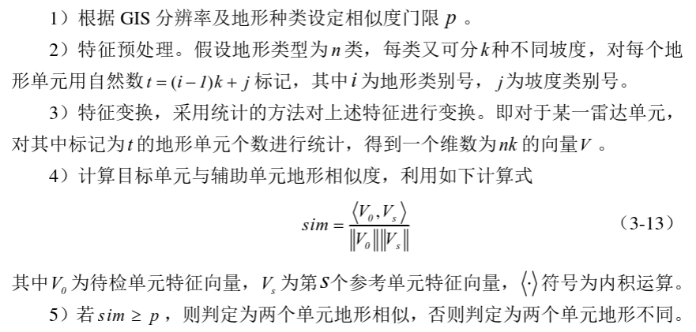
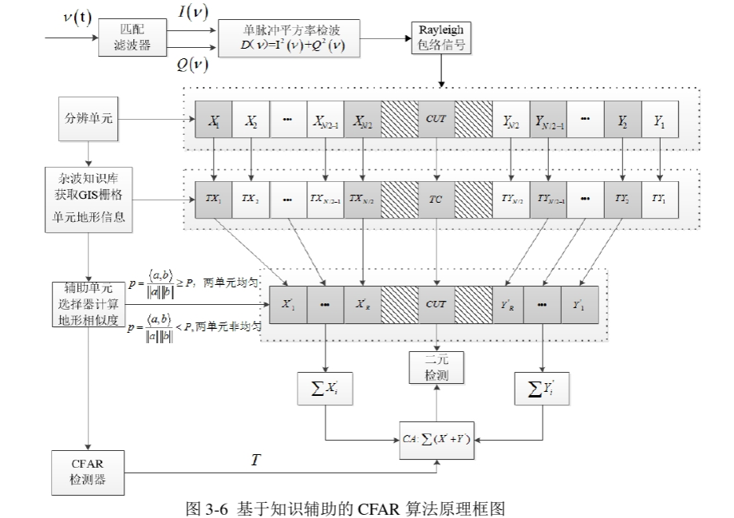
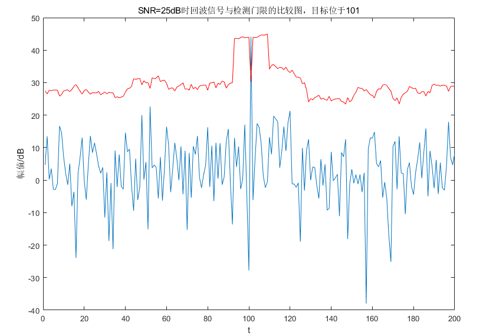

# [Constant False Alarm Detection] Fundamental Principles of Knowledge-Aided CFAR Algorithm Based on MATLAB Codes 7 Sets

The main principle is that the CFAR algorithm essentially estimates the parameters of clutter distribution using reference units. In an uniform environment, the estimation of these parameters is relatively accurate. However, due to the complexity of terrain, actual scenes are often non-uniform. Therefore, if all reference units are considered i.i.d., this would lead to biased parameter estimations, which in turn affects detection performance.
Considering clutter modeling involves generating corresponding clutter based on geographic information, it indicates that the distribution characteristics of clutter largely depend on the terrain features of radar resolution cells. Thus, it can be approximated that radar resolution cells with similar terrain have similar clutter power distribution characteristics; whereas radar resolution cells with different terrains have different clutter power distribution characteristics. This is the basis for introducing the KA method.
Based on the above considerations, the KA class methods can be divided into two steps: Step 1 is to determine the terrain similarity of radar resolution cells; Step 2 is to select terrain-similar reference windows and use traditional CFAR methods for binary hypothesis testing.
Next, let's analyze Step 1. In reality, the resolution of radar resolution cells is often lower than that of terrain cells. In other words, a radar resolution cell typically covers multiple geographical information cells. Assuming each radar resolution cell contains N terrain cells. For each terrain cell, its type and slope can be used as descriptions of its characteristic. Therefore, for each radar cell, a 2N-dimensional vector can be used to describe its geographical features. Below is the selection algorithm flow chart for assistive units:
It is important to note that this feature transformation method does not consider the specific location of a certain terrain within the region corresponding to a radar resolution cell but rather determines whether two radar cells have the same topography from the statistical total quantity of this terrain. The similarity calculation formula actually calculates the angle between two vectors, with sim ranging from 0 to 1 (since each element of the feature vector is a natural number, the value must be greater than 0), and the closer this value is to 1, the smaller the angle between the two vectors, indicating more similarity between the two vectors.
From the above, the specific steps for CFAR detection using knowledge assistance in non-uniform Gaussian clutter environment are as follows:
1) Obtain terrain coverage information corresponding to each grid cell based on the clutter environment knowledge base;
2) Acquire signal echoes and establish the position relationship between GIS units and resolution units;
3) Determine whether the uniformity of the inspected unit G0 is the same as that of the assisting unit Gj by combining the assisting unit selection algorithm;
4) Select assisting units with uniformity consistent with the inspected unit within the reference window and perform cascaded CA-CFAR detection.
Figure 3-6 provides a schematic diagram of the entire algorithm. In summary, the knowledge-assisted CFAR detection algorithm essentially judges the uniformity of the reference unit through geological features. Compared with traditional CFAR detection algorithms, there are two main improvements: (1) By introducing prior knowledge of clutter, preprocessing of resolution units is performed to achieve data filtering, thereby replacing the traditional CFAR algorithm's direct estimation based on actual echo signals; (2) The tracking of clutter edges is precisely down to individual resolution units, unlike the traditional CFAR algorithm which estimates all resolution units within the entire reference sliding window or half of the reference window.
MATLAB example code
s1=2; s2=4; fa=0; d=0; faPos=zeros(1,200); SNR = 25; noiseA1 = exprnd(s1,1,79); noiseA2 = exprnd(s1,1,80); clutter = exprnd(s2,1,41); A=2/(s1^2)*10^(SNR/10); SigPos = 101; % Target impulse position sigA = zeros(1,200); sigA(SigPos) = A; plus = [noiseA1 clutter noiseA2]; indata = sigA + plus; % Generate target echo n=8; Pf=1e-4; T=(Pf)^(-1/(2*n))-1; thresholdsave=zeros(1,200); for i=1:200    if 8<i&&i<=192        cwin=[i-8:i-1 i+1:i+8]; elseif i==1        cwin=[i+1:i+16]; elseif i>1&&i<=8        cwin=[1:i-1 i+1:17]; elseif i>=193&&i<200        cwin=[184:i-1 i+1:200]; elseif i==200        cwin=[i-16:i-1]; end    Z=sum(indata(1,cwin)); threshold=Z*T; thresholdsave(1,i)=threshold; if indata(1,i)>threshold&&i==SigPos             d=d+1; elseif indata(1,i)>threshold&&i~=SigPos             fa=fa+1; faPos(1,i)=i; endend% Comparison of echo signal with detection threshold % plot(20*log10(indata(1,:))); holdplot(20*log10(thresholdsave(1,:)),'r'); xlabel('t'); ylabel('Amplitude/dB')title('Comparison of echo signal and detection threshold at SNR=25dB, target located at 101')

## Images

<!-- PAYMENT_BLOCK -->

## Get this dataset

- Payment link (Stripe): [Buy now](https://buy.stripe.com/3cs8yP7sY87d0vu9AB)
- Payment QR code: 

<!-- /PAYMENT_BLOCK -->
